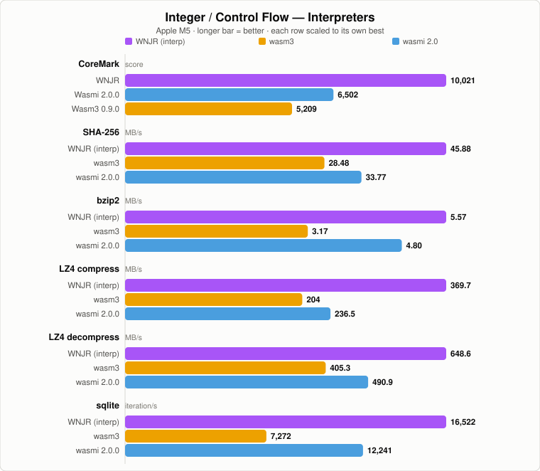
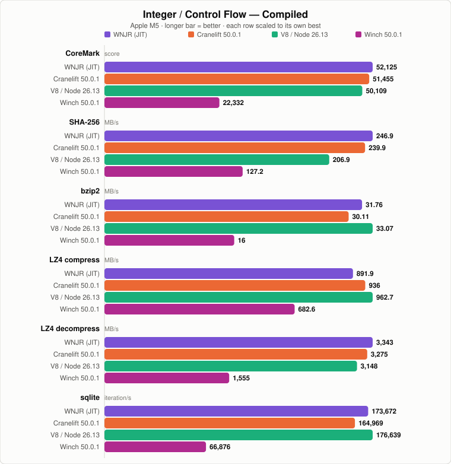
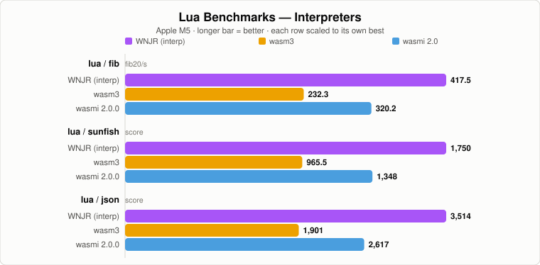

<div align="center">
  <h1>WNJR</h1>
  
  <p><strong>WASM NANO JIT RUNTIME
  for desktop and server platforms.
  </strong></p>


  Thanks to [SF](https://github.com/mbbill/Silverfir-nano)
  <p>
    
    
    
    
  </p>

  <p>
    <a href="#performance">Benchmarks</a> |
    <a href="#webassembly-compatibility">Wasm compatibility</a> |
    <a href="#validation">Validation</a> |
    <a href="docs/COMPILER_PIPELINE.md">Compiler pipeline</a>
  </p>
</div>

> **TLDR: this is the smallest with fastest WASM JIT RUNTIME you can find.**

## Highlights

WNJR is a `no_std` WebAssembly 3.0 runtime for desktop and server
platforms: x86_64, ARM64, and RV64GC. One optimizing JIT, always on. There is
no interpreter and no embedded target.

1. **Fast** — register-allocated, region-optimized native code. On the
   wasmi-benchmarks corpus the 0.7.0 JIT leads V8 and Wasmtime's
   fully-optimizing Cranelift on x64 Linux, x64 Windows and ARM64 macOS: they
   take a geomean 1.07–1.30× and 1.21–1.35× of its time. On this repository's
   WASI suite it is level with both
   ([WASI results](bench/wasi/README.md),
   [corpus standings](bench/wasmi_benchmarks/README.md)).
2. **Small** — the core uses `alloc` only. `std` is required only
   by the WASI crate and the debug dumpers.
3. **Three backends** — x86_64, ARM64 (A64), RISC-V 64 (RV64GC). They share
   one frontend, middle-end, and register allocator.
4. **Wasm 3.0** — GC (deferred reference counting), exception handling, SIMD
   and relaxed SIMD, tail calls, memory64, multi-memory, typeful references,
   and extended constant expressions.

## The compiler

The three backends share the same frontend, middle-end, and register
allocator. Two properties make the codegen what it is:

- **The pipeline is streamable end-to-end.** Each transform stage consumes
  its input and produces its output incrementally, per function. A fully
  materialized IR for the whole module is never held in memory.
- **The middle-end allocator is designed for JIT budget and good codegen.**
  [`ALGORITHM4`](docs/ALGORITHM4.md) is a region-based cost-optimal cache
  residency allocator that runs per function at JIT scale.

## The C frontend

`wnjr-cc` compiles C to **NJVM-IR**, the language frontends' interchange
format, and does not touch wasm directly: the transform path lowers the IR to
wasm bytes and hands them to the engine unchanged. It is a C program with its
own `Makefile`, based on [chibicc](https://github.com/rui314/chibicc) (MIT).

```bash
make -C wnjr-cc
wnjr-cc/wcc -o prog.njvm prog.c   # IR as MessagePack
./target/debug/njvm-run prog.njvm main             # read, lower, run on WNJR
make -C wnjr-cc test                              # -E and --dump-ast vs chibicc
wnjr-cc/test/e2e.sh                               # C -> IR -> WNJR vs the host cc
wnjr-cc/test/bootstrap.sh                         # wcc builds itself, on WNJR
```

**It compiles itself.** `test/bootstrap.sh` compiles the compiler's own
translation units and the whole libc into one NJVM module — 274 files, 14.4 MB
of module — and then runs that module *on WNJR* to compile the same sources
again. The module wcc emits and the module the compiler built by wcc emits are
the same bytes; a second generation reproduces them a third time. So the
compiler that builds the compiler is a wasm program running on this engine, and
it agrees with the native one byte for byte.

Every C object lives in linear memory at a frame-relative address (the
prologue sets `fp = sp - frame_size`, `sp = fp`; each `return` restores it), so
taking the address of anything needs no special case, and the function body is
a flat CFG of labels and jumps — the shape the IR verifier wants. `goto *p`
and `&&label` go in as `Op::GotoIndirect` / `Expr::LabelAddr` and are lowered
by `njvm/computed_goto.rs`. The interchange format is documented in
`wnjr-njvm-io/src/lib.rs`; the C writer produces byte-identical output.

Implemented today: integer and floating-point arithmetic, comparisons,
conversions, pointers, arrays, structs and unions (as memory), `if`/`for`/
`while`/`do`, `switch` (including `case 1 ... 5`), `goto`, computed goto,
recursion, calls to functions defined in the same translation unit, and every
object with a static extent — globals (initialised, zero-initialised, with
pointer initialisers such as `char *p = s + 1`), string literals, static
locals, and arrays of pointers to string literals — each placed in a data
segment.

A function pointer is an index into a `funcref` table that holds function
`i` at index `i`, so taking a function's address costs nothing and an
indirect call is `call_indirect` with the signature the pointer's C type
spells out: each distinct signature becomes one entry in the module's type
list, collected while the bodies are emitted. Function addresses work
anywhere a value does, including a static initialiser (a relocation whose
target is a function).

Structs and unions travel by value with the same trick the objects already
use: the value of an aggregate expression is its address. A parameter
arrives as the address of the caller's object and the callee copies it into
its own frame in the prologue, so writing to a parameter cannot reach the
caller and `&param` is a per-activation address; a return goes through a
hidden first parameter pointing at a buffer the caller allocated (parse.c
already gives each such call a local for it), so nothing wider than a wasm
value has to cross the boundary; assignment is a `memory.copy`. Both struct
parameters and struct returns are therefore one `i32` each in a function
pointer's signature, which is why the two features meet cleanly.

A function this file only declares can be bound to a host function with wasi's
import attribute, spelled the way wasi-libc spells it:

```c
int fd_write(unsigned int fd, void *iovs, unsigned int n, unsigned int *written)
    __attribute__((__import_module__("wasi_snapshot_preview1"),
                   __import_name__("fd_write")));
```

Imported functions take the low half of the function index space (wasm's own
ordering), which is why an import also has a function address and can be called
through a function pointer. Both attribute names are required together, and an
attribute name the frontend does not know is an error rather than something
dropped on the floor. Two shapes are refused rather than quietly miscompiled: a
variadic import, since a wasm import has a fixed signature and the extra
arguments have no way across, and an import returning a struct or union, since
this frontend returns those through a hidden parameter an outside function does
not know about. That is not where `printf` belongs anyway: `printf` is libc,
compiled by this frontend like any other code, and it reaches the host through
`fd_write`.

A declaration can also carry `export_name("..."), which renames what the module
exports without renaming the function inside it, and `__attribute__((used))`,
which keeps a definition the module would otherwise have no reason to name.

The attribute vocabulary is the one a C library actually writes. `packed`,
`aligned`, the two import names and `export_name` are honoured; the annotation
words that change nothing here — `__nothrow__`, `__leaf__`, `__pure__`,
`__const__`, `__malloc__`, `__warn_unused_result__`, `__nonnull__`,
`__deprecated__`, `__cold__`, `__weak__`, `__may_alias__`, `__format__`,
`visibility`, `noinline`, `always_inline`, `nodebug` — are read past, because the
module is one file with every body in it and there is no optimiser to inform.
Everything else is still an error: an attribute dropped on the floor is a wrong
program a long way from its cause. `_Static_assert` is checked at file scope and
inside functions.

A variadic function's `...` arguments travel in memory, because a wasm signature
is fixed and there is no register file to spill. The caller lays them out in a
buffer of its own frame — one eight-byte slot each, a wider alignment padding
first, an address zero-extended into its slot — and passes that buffer's address
as one more parameter after the declared ones. The callee's prologue saves the
pointer, and `va_start` builds a `va_list` that reads only that memory path: both
of the register counters start spent (`gp_offset` 48, `fp_offset` 112) and
`reg_save_area` is null, so every `va_arg` walks the buffer in order.

`va_list` is a struct, and the type belongs to the frontend, so that
`<stdarg.h>`'s spelling and wasi-libc's `typedef __builtin_va_list va_list` name
the same type. It is a struct rather than a pointer because `va_list ap;` has to
be storage for a cursor: `va_copy` is then a struct copy with a position of its
own, which is what musl's `vfprintf` relies on when it copies its argument list to
walk the format twice and then passes the copy by value to `printf_core`. The
`__builtin_va_*` spellings musl uses expand to the same four operations.

The builtins a C library actually calls are not a library call. `__builtin_trap`
and `__builtin_unreachable` are an `unreachable` instruction;
`__builtin_clz`, `__builtin_ctz` and `__builtin_popcount` (and their `ll` forms)
are the counts the backend already has; `__builtin_memcpy` and
`__builtin_memmove` are one `memory.copy`, `__builtin_memset` one `memory.fill`;
`__builtin_isnan` is `x != x` with the operand read once; `__builtin_expect` is
its first argument, `__builtin_constant_p` is 0 because there is no optimiser to
tell, and `__builtin_assume` is a statement that is parsed and dropped.

GCC's `alias` attribute is a real mechanism rather than an annotation: a
declaration carrying `__attribute__((alias("f")))` takes `f`'s function index, and
the module exports one function under two names. A call through either name, and a
function pointer taken through either name, reach the same body. An alias of an
alias resolves through the chain.

Not yet: VLAs, bitfields, `_Atomic`, `asm`, the wasm builtins
(`__builtin_wasm_memory_size`, `__builtin_wasm_memory_grow`, the `tls` ones,
`__builtin_wasm_memory_atomic_wait32`), the overflow builtins
(`__builtin_add_overflow` and friends), `__sync_*` atomics, the floating-point
classification builtins other than `isnan`, and a struct or union passed through
`...`. libc itself is next.

The type table is chibicc's LP64 one, so `long` and a pointer are eight bytes
wide; only the low 32 bits of a pointer slot are an address, and the upper half
is reserved for the GC tag of the tagged-pointer model. Codegen reads every
width from that table, so moving to ILP32 would be a change to `type.c` alone.

The target is wasm32-wasip1-threads, and the predefined macros say so:
`__wasm__`, `__wasm32__`, `__wasi__`, `__wasip1__`, and no `__x86_64__`,
`__linux__` or `__ELF__`, because the machine the compiler happens to run on is
not the machine it compiles for. `test/libc-parse.sh` measures the frontend
against the real thing: it preprocesses and parses every source file in
`wnjr-cc-libc` with wasi-libc's own include path and prints one line per file
that fails, with the first error. It is the number to watch while the frontend
grows enough to compile a C library.

## WebAssembly compatibility

Validated against the official
[WebAssembly spec testsuite](https://github.com/WebAssembly/spec/tree/main/test).

| | |
|---|---|
| Wasm 1.0 / 2.0 core | yes |
| Bulk memory, reference types, `table.*` | yes |
| Multiple memories | yes |
| Imported memories, tables, globals | yes |
| Extended const expressions | yes |
| Typeful references | yes |
| Tail calls | yes |
| Exception handling | yes |
| `memory64` / `table64` | yes |
| SIMD / relaxed SIMD | ARM64 and x86_64 |
| Garbage collection | yes, deferred reference counting |
| Threads (shared memory, atomics, wait/notify) | ARM64 and x86_64; one instance per thread, sharing compiled code and the shared memory. Not on RV64. See [docs/THREADS.md](docs/THREADS.md) |
| Shared memory64 (`memory64` + `shared`) | no. memory64 and shared memory each work alone; the combination is rejected |

JIT SIMD requires ARM64 NEON or x86_64 SSSE3 and SSE4.1. Guest
exception-handling support does not imply identical host-callback behavior:
the JIT propagates host-thrown exceptions to the embedder.

The Wasm 3.0 feature groups in detail:

- **Extended constant expressions** — arithmetic in const expressions and
  `global.get` of previously declared immutable globals.
- **Tail calls** — `return_call`, `return_call_indirect`, and
  `return_call_ref`.
- **Multiple memories** — multi-memory definitions, imports, exports, and
  indexed memory operations.
- **64-bit address space** — `memory64`, `table64`, and the
  corresponding `i64`-typed memory and table instruction paths.
- **Typeful references** — typed `ref null`, `ref.func`,
  `call_ref`, `br_on_null`, `br_on_non_null`, refined local
  initialization rules, and typed table initializers.
- **Garbage collection** — deferred reference counting. Recursive types,
  subtyping, `struct.*`, `array.*`, `ref.test`,
  `ref.cast`, `br_on_cast`, `br_on_cast_fail`,
  `ref.i31`, `any.convert_extern`, and `extern.convert_any`.
  Objects live in a per-instance arena and are reclaimed by reference count,
  not by tracing.
- **Baseline SIMD** — `v128` values, loads and stores, lane ops, bitwise
  ops, arithmetic, comparisons, and conversions, on ARM64 and x86_64.
- **Relaxed SIMD** — relaxed swizzle, truncation, min/max, lane-select,
  q15mulr, dot-product, and madd/nmadd, on ARM64 and x86_64.
- **Exception handling** — tags, `throw`, `throw_ref`, and
  `try_table`.

## Performance


<table>







</table>

## Building

```bash
cargo build --release

# Run a WASI program
cargo run --release --bin wnjr-cli -- program.wasm [args...]

# Spec testsuite
cargo run --release -p wnjr-tests --bin wnjr-spectest

# Benchmarks (each one self-times to ~2s)
python3 bench/wasi/run_tests.py

# Rebuild the benchmark wasm binaries from source (needs wasi-sdk clang)
make -C bench/wasi
```

The C frontend's end-to-end check compares every call against the host C
compiler; it needs a built `wnjr-cc` and writes its scratch files under
`$TMPDIR/wnjr-cc-e2e`:

```bash
make -C wnjr-cc && wnjr-cc/test/e2e.sh
```

Diagnostics are environment variables:
`WNJR_CALL_TRACE`, `WNJR_JIT_DEBUG`, `WNJR_JITDUMP`,
`WNJR_MEMPROF`.

## Validation

```bash
cargo build --workspace
cargo test --workspace
```


## License

Apache-2.0. The full text is in [LICENSE](LICENSE).
