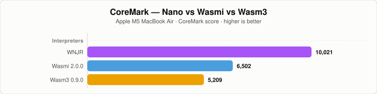
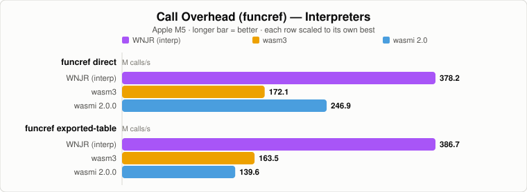
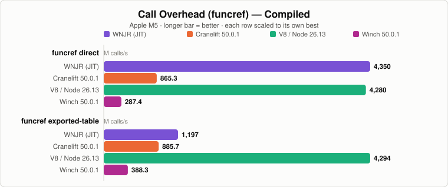
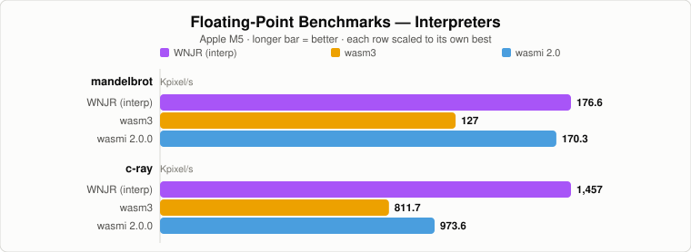
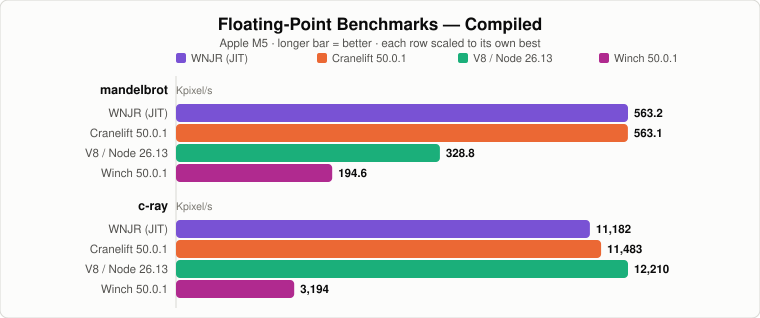
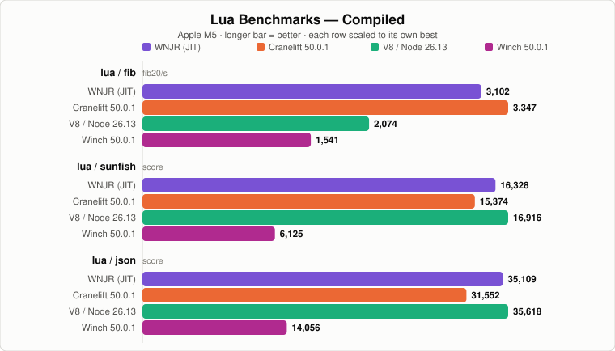
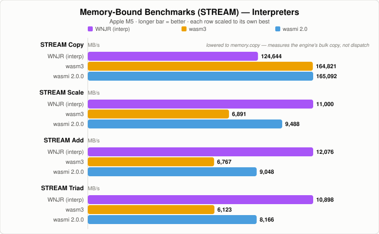
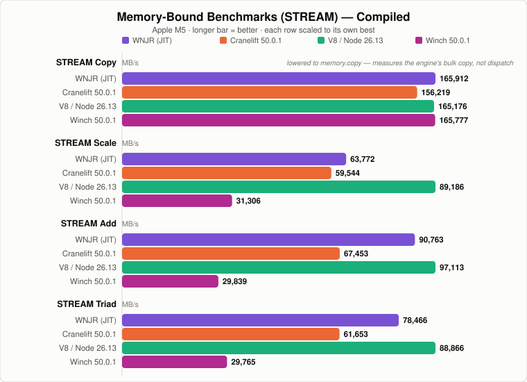

<div align="center">
  <h1>WNJR</h1>
  
  <p><strong>WASM NANO JIT RUNTIME
  for desktop and server platforms.
  </strong></p>


  Thanks to [SF](https://github.com/mbbill/Silverfir-nano)
  <p>
    
    
    
    
  </p>

  <p>
    <a href="#performance">Benchmarks</a> |
    <a href="#webassembly-compatibility">Wasm compatibility</a> |
    <a href="#validation">Validation</a> |
    <a href="docs/COMPILER_PIPELINE.md">Compiler pipeline</a>
  </p>
</div>

> **TLDR: this is the smallest with fastest WASM JIT RUNTIME you can find.**

## Highlights

WNJR is a `no_std` WebAssembly 3.0 runtime for desktop and server
platforms: x86_64, ARM64, and RV64GC. One optimizing JIT, always on. There is
no interpreter and no embedded target.

1. **Fast** — register-allocated, region-optimized native code. On the
   wasmi-benchmarks corpus the 0.7.0 JIT leads V8 and Wasmtime's
   fully-optimizing Cranelift on x64 Linux, x64 Windows and ARM64 macOS: they
   take a geomean 1.07–1.30× and 1.21–1.35× of its time. On this repository's
   WASI suite it is level with both
   ([WASI results](bench/wasi/README.md),
   [corpus standings](bench/wasmi_benchmarks/README.md)).
2. **Small** — the core uses `alloc` only. `std` is required only
   by the WASI crate and the debug dumpers.
3. **Three backends** — x86_64, ARM64 (A64), RISC-V 64 (RV64GC). They share
   one frontend, middle-end, and register allocator.
4. **Wasm 3.0** — GC (deferred reference counting), exception handling, SIMD
   and relaxed SIMD, tail calls, memory64, multi-memory, typeful references,
   and extended constant expressions.

## The compiler

The three backends share the same frontend, middle-end, and register
allocator. Two properties make the codegen what it is:

- **The pipeline is streamable end-to-end.** Each transform stage consumes
  its input and produces its output incrementally, per function. A fully
  materialized IR for the whole module is never held in memory.
- **The middle-end allocator is designed for JIT budget and good codegen.**
  [`ALGORITHM4`](docs/ALGORITHM4.md) is a region-based cost-optimal cache
  residency allocator that runs per function at JIT scale.

## WebAssembly compatibility

Validated against the official
[WebAssembly spec testsuite](https://github.com/WebAssembly/spec/tree/main/test).

| | |
|---|---|
| Wasm 1.0 / 2.0 core | yes |
| Bulk memory, reference types, `table.*` | yes |
| Multiple memories | yes |
| Imported memories, tables, globals | yes |
| Extended const expressions | yes |
| Typeful references | yes |
| Tail calls | yes |
| Exception handling | yes |
| `memory64` / `table64` | yes |
| SIMD / relaxed SIMD | ARM64 and x86_64 |
| Garbage collection | yes, deferred reference counting |
| Threads (shared memory, atomics, wait/notify) | ARM64 and x86_64; one instance per thread, sharing compiled code and the shared memory. Not on RV64. See [docs/THREADS.md](docs/THREADS.md) |
| Shared memory64 (`memory64` + `shared`) | no. memory64 and shared memory each work alone; the combination is rejected |

JIT SIMD requires ARM64 NEON or x86_64 SSSE3 and SSE4.1. Guest
exception-handling support does not imply identical host-callback behavior:
the JIT propagates host-thrown exceptions to the embedder.

The Wasm 3.0 feature groups in detail:

- **Extended constant expressions** — arithmetic in const expressions and
  `global.get` of previously declared immutable globals.
- **Tail calls** — `return_call`, `return_call_indirect`, and
  `return_call_ref`.
- **Multiple memories** — multi-memory definitions, imports, exports, and
  indexed memory operations.
- **64-bit address space** — `memory64`, `table64`, and the
  corresponding `i64`-typed memory and table instruction paths.
- **Typeful references** — typed `ref null`, `ref.func`,
  `call_ref`, `br_on_null`, `br_on_non_null`, refined local
  initialization rules, and typed table initializers.
- **Garbage collection** — deferred reference counting. Recursive types,
  subtyping, `struct.*`, `array.*`, `ref.test`,
  `ref.cast`, `br_on_cast`, `br_on_cast_fail`,
  `ref.i31`, `any.convert_extern`, and `extern.convert_any`.
  Objects live in a per-instance arena and are reclaimed by reference count,
  not by tracing.
- **Baseline SIMD** — `v128` values, loads and stores, lane ops, bitwise
  ops, arithmetic, comparisons, and conversions, on ARM64 and x86_64.
- **Relaxed SIMD** — relaxed swizzle, truncation, min/max, lane-select,
  q15mulr, dot-product, and madd/nmadd, on ARM64 and x86_64.
- **Exception handling** — tags, `throw`, `throw_ref`, and
  `try_table`.

## Performance



<table>









</table>

## Building

```bash
cargo build --release

# Run a WASI program
cargo run --release --bin wnjr-cli -- program.wasm [args...]

# Spec testsuite
cargo run --release -p wnjr-tests --bin wnjr-spectest

# Benchmarks (each one self-times to ~2s)
python3 bench/wasi/run_tests.py

# Rebuild the benchmark wasm binaries from source (needs wasi-sdk clang)
make -C bench/wasi
```

Diagnostics are environment variables:
`WNJR_CALL_TRACE`, `WNJR_JIT_DEBUG`, `WNJR_JITDUMP`,
`WNJR_MEMPROF`.

## Validation

```bash
cargo build --workspace
cargo test --workspace
```


## License

Apache-2.0. The full text is in [LICENSE](LICENSE).
